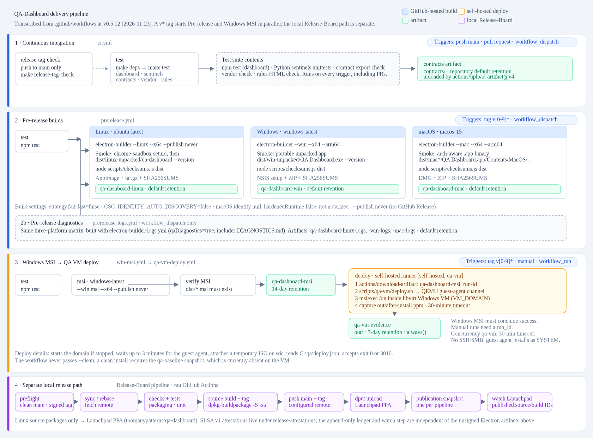

# Delivery pipeline



Transcribed from `.github/workflows/`, `electron-builder.yml` and
`scripts/qa-vm/` at tag `v0.5.12` (2026-11-23).

## Workflow map

| Workflow | Trigger | Runner | Output |
| --- | --- | --- | --- |
| `ci.yml` — QA Set CI | push `main`, pull request, manual | GitHub-hosted Ubuntu | `contracts` artifact |
| `prerelease.yml` — Pre-release | tag `v[0-9]*`, manual | GitHub-hosted Ubuntu / Windows / macOS | `qa-dashboard-{linux,win,mac}` artifacts |
| `prerelease-logs.yml` — Pre-release diagnostics | manual only | GitHub-hosted Ubuntu / Windows / macOS | `qa-dashboard-*-logs` artifacts |
| `win-msi.yml` — Windows MSI | tag `v[0-9]*`, manual | GitHub-hosted Windows | `qa-dashboard-msi` artifact |
| `qa-vm-deploy.yml` — QA VM deploy | `Windows MSI` completed, or manual with `run_id` | self-hosted `[qa-vm]` | `qa-vm-evidence` artifact |

A `v*` tag starts **Pre-release** and **Windows MSI** in parallel. The deploy
workflow follows Windows MSI only.

## 1. Continuous integration (`ci.yml`)

- `release-tag-check` runs only for a push to `main`; it calls
  `make release-tag-check`.
- `test` runs for every trigger:
  `make deps` then `make test`, which covers the dashboard tests, Python
  sentinels unittests, contract export check, vendor check and rules HTML check.
- The `contracts/` directory is uploaded as the `contracts` artifact with the
  repository default retention.

## 2. Pre-release builds (`prerelease.yml`)

`test` runs `npm test`, then three build jobs run with `fail-fast: false`:

| Platform | Runner | electron-builder | Smoke test | Artifact |
| --- | --- | --- | --- | --- |
| Linux | `ubuntu-latest` | `--linux --x64` | setuid `chrome-sandbox`, then `linux-unpacked/qa-dashboard --version` | `qa-dashboard-linux` |
| Windows | `windows-latest` | `--win --x64 --arm64` | `win-unpacked/QA Dashboard.exe --version` | `qa-dashboard-win` |
| macOS | `macos-15` | `--mac --x64 --arm64` | arch-aware `.app/Contents/MacOS/QA Dashboard --version` | `qa-dashboard-mac` |

Each build then runs `node scripts/checksums.js dist`, which hashes the
installers and `PRERELEASE.md` into `SHA256SUMS`, and uploads:

```text
dist/*.exe  dist/*.zip  dist/*.dmg  dist/*.AppImage  dist/*.tar.gz  dist/SHA256SUMS
```

Build settings:

- `--publish never`: nothing is attached to a GitHub Release.
- `CSC_IDENTITY_AUTO_DISCOVERY=false`; macOS uses `identity: null`, DMG signing
  off and hardened runtime off. Builds are unsigned and not notarized.
- `qa-dashboard-{linux,win,mac}` use the repository default retention. No
  `retention-days` is set.
- The upload glob does **not** include `*.msi`; the MSI is published only by
  `win-msi.yml`.

## 2b. Pre-release diagnostics (`prerelease-logs.yml`)

Manual-only copy of the three-platform matrix. It builds with
`electron-builder-logs.yml`, which adds `electron/diagnostics.js` and
`DIAGNOSTICS.md`, sets `qaDiagnostics=true`, and suffixes artifact names with
`-logs`. Output uses the repository default retention. This workflow does not
publish or deploy.

## 3. Windows MSI and QA VM deploy

### Windows MSI (`win-msi.yml`)

- `test` runs `npm test`.
- `msi` runs on `windows-latest`:
  `npx electron-builder --win msi --x64 --publish never`.
- Verification fails the job if no `dist/*.msi` exists, then prints its name
  and size.
- `dist/*.msi` is uploaded as `qa-dashboard-msi` with `retention-days: 14`.

### QA VM deploy (`qa-vm-deploy.yml`)

- Triggered by a completed `Windows MSI` run, but the job runs only when that
  run concluded `success`. Manual dispatch requires a `run_id`.
- Runs on the self-hosted Linux runner labelled `qa-vm`; concurrency group
  `qa-vm`, `cancel-in-progress: false`, 30-minute timeout.
- Downloads `qa-dashboard-msi` for the triggering run using `GITHUB_TOKEN`,
  then runs `scripts/qa-vm/deploy.sh <msi>`.
- Deploy path, with no SSH or SMB:
  1. Start the libvirt domain if it is stopped (`VM_DOMAIN`, default `win11`).
  2. Wait up to 3 minutes for `qemu-guest-agent`.
  3. Build a temporary ISO containing the MSI and `guest/deploy.ps1`, attach it
     on `sdc`, and execute PowerShell in the guest as SYSTEM.
  4. `msiexec /i ... /qn /norestart /l*v C:\qa\msi.log`; exit code 0 or 3010
     is success. The result is read back from `C:\qa\deploy.json`.
  5. Capture `out/after-install.ppm`.
- `out/` is uploaded as `qa-vm-evidence` with `retention-days: 7` and
  `if-no-files-found: ignore`, even on failure.
- The workflow does not pass `--clean`; that path would require the
  `qa-baseline` snapshot.

## 4. Separate local release path (Release-Board)

Not part of GitHub Actions. `release-board pipeline --root <repo> --confirm`
handles Linux source releases to Launchpad PPA
(`toomanypatterns/qa-dashboard`):

`preflight → sync/rebase → checks and tests → source build + signed tag →
push main and tag → dput upload → publication snapshot → watch Launchpad`

It produces `.changes`, `.dsc` and `.buildinfo` packages, SLSA v1 attestations
under `release/attestations/`, and ledger entries. The unsigned Electron
artifacts from GitHub Actions are a separate track.

## Artifacts and retention

| Artifact | Produced by | Contents | Retention |
| --- | --- | --- | --- |
| `contracts` | `ci.yml` | exported contracts | repository default |
| `qa-dashboard-linux` | `prerelease.yml` | AppImage, tar.gz, SHA256SUMS | repository default |
| `qa-dashboard-win` | `prerelease.yml` | NSIS setup, zip, SHA256SUMS | repository default |
| `qa-dashboard-mac` | `prerelease.yml` | DMG, zip, SHA256SUMS | repository default |
| `qa-dashboard-*-logs` | `prerelease-logs.yml` | diagnostics builds | repository default |
| `qa-dashboard-msi` | `win-msi.yml` | per-machine x64 MSI | 14 days |
| `qa-vm-evidence` | `qa-vm-deploy.yml` | install screenshot | 7 days |

The repository default is normally 90 days and can be lowered in repository or
organization settings. Artifacts disappear when they expire or when the run is
deleted; nothing is retained in a GitHub Release.

## Current state (2026-11-23)

- `Pre-release` succeeded for `v0.5.12`.
- `Windows MSI` failed for `v0.5.11` and `v0.5.12` with
  `EBUSY: resource busy or locked, copyfile ... PRERELEASE.md` during
  `electron-builder`.
- Because the MSI runs failed, the automatic `QA VM deploy` runs were skipped.
- The last real deploy attempt (`v0.5.10`) failed with
  `failed to get domain 'win11'`.
- The `win11` domain is running again but has no `qa-baseline` snapshot, so a clean
  deploy is not available.

## Security notes

- All GitHub-hosted workflows run with `permissions: contents: read`; the
  deploy workflow adds `actions: read` to download the MSI artifact.
- Deploy is limited to the self-hosted `qa-vm` runner and the QEMU guest-agent
  channel; no network share or SSH entry point is used.
- Builds are unsigned and not notarized. Windows SmartScreen and macOS
  Gatekeeper warnings are expected.
- The MSI and deploy evidence expire; download them before retention ends if
  they are needed as release evidence.
